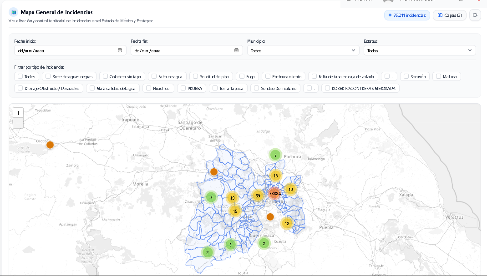
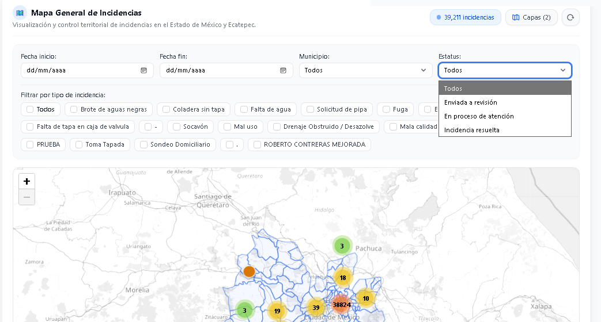
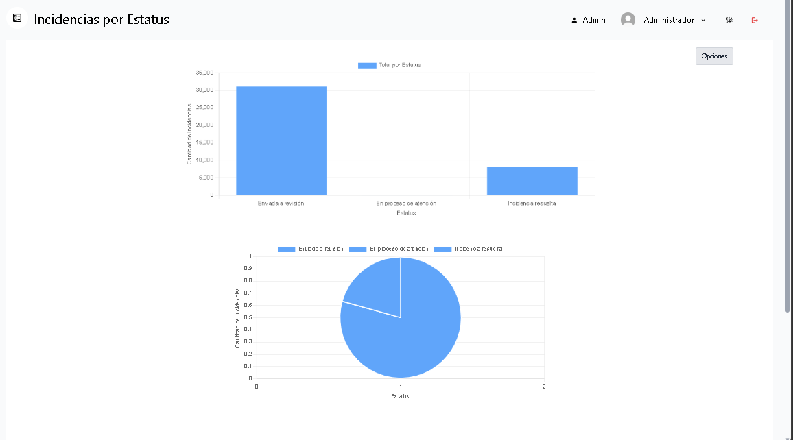
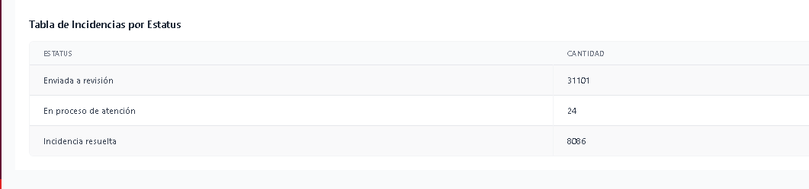
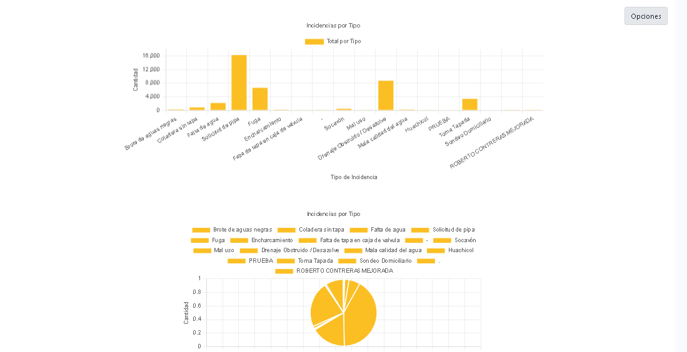
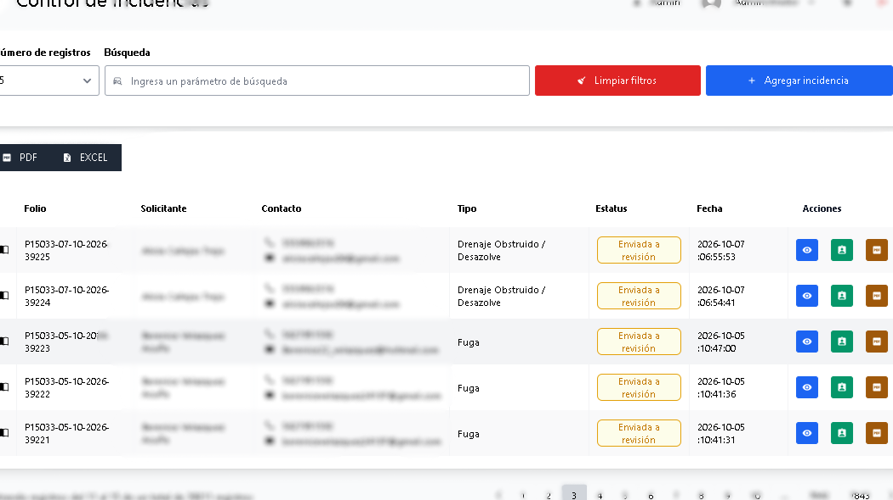
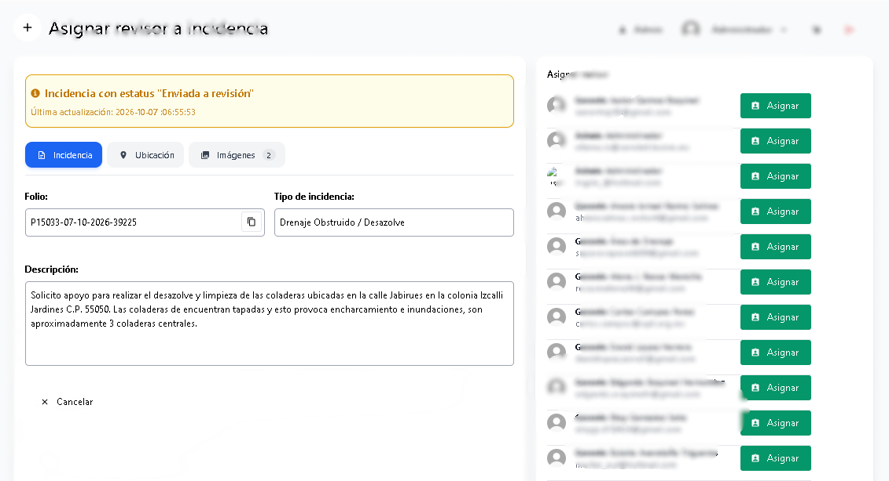

<h1 align="center">📂 Portafolio de Sistemas en Producción & Casos de Estudio</h1>

  <b>Felipe Trujillo — Full-Stack Developer</b> 
  📧 <a href="mailto:f97930356@gmail.com">f97930356@gmail.com</a> • 🐙 <a href="https://github.com/dptrujillo">github.com/dptrujillo</a>

> **Nota sobre la confidencialidad:** Este repositorio documenta la arquitectura, retos técnicos y evidencia visual de sistemas desarrollados para instituciones públicas y clientes privados. Por políticas de propiedad intelectual y protección de datos, el código fuente propietario no es público.

---

## 📑 Índice de Proyectos
1. [Sistema Integral de Gestión de Incidentes Hidráulicos (CENIDET / CAEM - CONAGUA)](#-1-sistema-integral-de-gestión-de-incidentes-hidráulicos-cenidet--caem)
2. [Plataforma de Gestión de Contenido Académico (CITCA - CENIDET)](#-2-plataforma-de-gestión-de-contenido-académico-citca---cenidet)
3. [Panel Administrativo y Sistema de Reservas (Sweet Surprise)](#-3-panel-administrativo-y-sistema-de-reservas-sweet-surprise)

---

## 🗺️ 1. Sistema Integral de Gestión de Incidentes Hidráulicos (CENIDET / CAEM)

**Rol:** Full-Stack Developer | **Modalidad:** Remoto, México  
**Estado:** Desplegado en producción

### 🎯 El Reto Técnico
Centralizar, geolocalizar y dar seguimiento en tiempo real a un alto volumen de reportes ciudadanos sobre infraestructura hidráulica, garantizando que el mapa interactivo y los tableros analíticos mantuvieran una respuesta fluida incluso al cargar miles de registros simultáneos.

### 🛠️ Stack Tecnológico
`PHP` `Laravel` `Eloquent ORM` `Vue.js` `Inertia.js` `Tailwind CSS` `MySQL` `Leaflet.js` `Git/GitHub`

### ⚙️ Arquitectura y Soluciones Implementadas
- **Procesamiento a gran escala:** Desarrollo del núcleo del sistema soportando la gestión activa de **más de 15,000 reportes ciudadanos**.
- **Geolocalización de alto rendimiento:** Integración de mapas interactivos con **Leaflet.js**, optimizando la consulta y renderización para mostrar miles de marcadores simultáneos sin caída de rendimiento en el navegador.
- **Flujo operativo multirrol:** Programación del sistema de permisos y asignación para tres niveles operativos (**Administrador, Revisor y Técnico**), permitiendo la canalización y escalamiento ordenado de tickets.
- **Analítica de datos:** Construcción de módulos estadísticos y gráficas de frecuencia de fallas para identificar zonas críticas y tiempos de respuesta.

### 📸 Capturas del Sistema

#### Mapa Interactivo y Marcadores (Leaflet.js)
| Mapa Interactivo y Marcadores (Leaflet.js) |
| :---: |
|  |
| *Renderización optimizada de reportes geolocalizados* |

#### Panel Analítico de Incidencias 
| Panel Analítico - Vista 1 | Panel Analítico - Vista 2 |
| :---: | :---: |
|  |  |
| *Métricas de frecuencia de fallas y estado de atención* | *Gráficas de distribución y análisis de incidencias* |
| **Panel Analítico - Vista 3** | **Panel Analítico -  |
|  |  |
| *Indicadores operativos y tiempos de respuesta* | *Estadísticas detalladas de reportes ciudadanos* |

#### Gestión y Escalamiento de Tickets Multirrol 
| Gestión de Tickets - Vista 1 | Gestión de Tickets  |
| :---: | :---: |
|  |  |
| *Vista de asignación y control para administradores y revisores* | *Seguimiento y escalamiento de tickets para técnicos* |

---

## 📊 2. Plataforma de Gestión de Contenido Académico (CITCA - CENIDET)

**Rol:** Full-Stack Developer | **Modalidad:** Remoto, México  
**Estado:** Sistema interno institucional *(Servidor temporalmente fuera de línea tras cierre de convocatoria)*

### 🎯 El Reto Técnico
Diseñar desde cero una plataforma segura y auditable para automatizar la recepción, asignación de evaluadores y dictaminación de artículos académicos, eliminando cuellos de botella manuales y garantizando que cada perfil tuviera acceso estrictamente a las funciones de su rol.

### 🛠️ Stack Tecnológico
`PHP` `Laravel` `Vue.js` `Pinia` `Inertia.js` `Tailwind CSS` `MySQL` `RESTful APIs`

### ⚙️ Arquitectura y Soluciones Implementadas
- **Seguridad y Control de Accesos (RBAC):** Arquitectura e implementación de un sistema avanzado de Control de Acceso Basado en Roles para gestionar permisos granulares entre autores, comité evaluador y administradores.
- **Flujos de trabajo dinámicos:** Desarrollo de la lógica de negocio para la asignación automatizada y manual de artículos, control de estados de evaluación y emisión de dictámenes.
- **Dashboards de monitoreo en tiempo real:** Creación de paneles de control con gráficas analíticas para supervisar indicadores clave (KPIs), como **tasas de aceptación de artículos** y **tiempos promedio de revisión**.

### 📸 Capturas del Sistema

#### Dashboard de Métricas y Tasas de Aceptación (2 vistas)
| Dashboard de Métricas - Vista 1 | Dashboard de Métricas - Vista 2 |
| :---: | :---: |
|  |  |
| *Monitoreo en tiempo real de tasas de aceptación* | *Gráficas analíticas de tiempos de revisión* |

#### Flujo de Asignación y Revisión de Artículos (2 vistas)
| Flujo de Artículos - Vista 1 | Flujo de Artículos - Vista 2 |
| :---: | :---: |
|  |  |
| *Asignación dinámica de artículos a revisores* | *Interfaz de seguimiento y dictaminación por pares* |

#### Administración de Roles y Permisos - RBAC (2 vistas)
| Control RBAC - Vista 1 | Control RBAC - Vista 2 |
| :---: | :---: |
|  |  |
| *Gestión de usuarios y roles del sistema* | *Configuración granular de permisos y accesos* |

---

## 📅 3. Panel Administrativo y Sistema de Reservas (Sweet Surprise)

**Rol:** Web Developer Freelance | **Modalidad:** Remoto, México  
**Estado:** Entregado al cliente

### 🎯 El Reto Técnico
Digitalizar la administración de reservas de servicios personalizados mediante una plataforma centralizada que evitara traslapes de horarios y permitiera gestionar la operación diaria según el nivel de acceso del personal.

### 🛠️ Stack Tecnológico
`PHP` `Laravel` `JavaScript` `Vue.js` `MySQL` `Tailwind CSS / Bootstrap`

### ⚙️ Arquitectura y Soluciones Implementadas
- **Gestión de disponibilidad:** Implementación de calendarios interactivos para visualizar, agendar y actualizar reservas en tiempo real.
- **Panel administrativo a la medida:** Construcción de módulos para el control de clientes, catálogo de servicios personalizados y seguimiento de estados de reserva.
- **Control de usuarios:** Sistema de autenticación y autorización por roles para separar las tareas operativas de la administración general.

### 📸 Capturas del Sistema
| Calendario Interactivo de Reservas | Panel de Administración de Servicios |
| :---: | :---: |
|  |  |
| *Control visual de fechas y horarios disponibles* | *Administración de reservas y roles de usuario* |

---

  ¿Te interesa conocer más detalles técnicos sobre la arquitectura o las consultas de base de datos de alguno de estos proyectos? 
  <b>Contáctame en <a href="mailto:f97930356@gmail.com">f97930356@gmail.com</a> para agendar una demostración técnica.</b>

